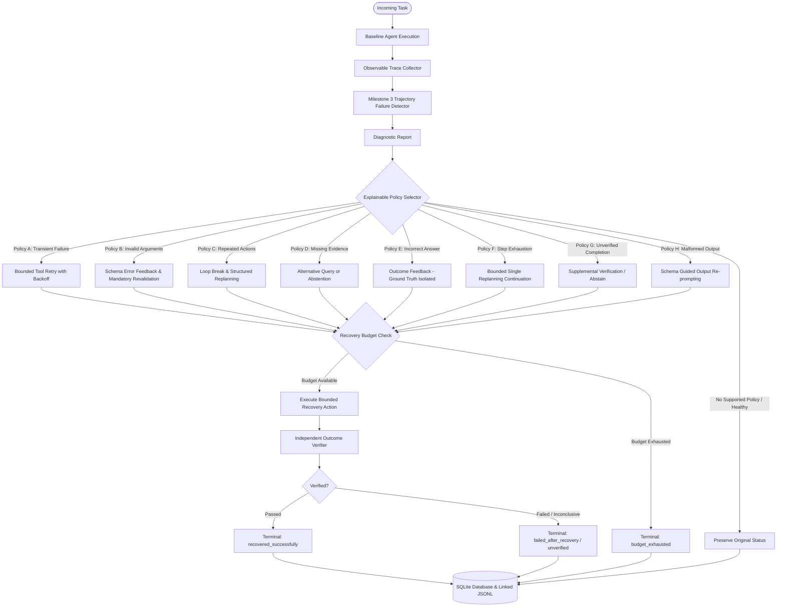

# TraceGuard: An Evidence-Driven Reliability and Recovery Platform for Tool-Using AI Agents

**Milestones 1, 2, 3 & 4: Baseline Agent, Benchmark Framework, Trajectory Failure Detector, & Failure-Specific Recovery Engine**

TraceGuard is a research and reliability engineering platform designed for autonomous, tool-using AI agents.

- **Milestone 1** established the modular baseline agent architecture: task planning, deterministic tool execution, observable trace event recording, and deterministic outcome verification.
- **Milestone 2** introduced a reproducible, versioned benchmark dataset (44 tasks across 5 categories), a failure-injection framework covering 8 controlled failure modes, an experiment execution runner, robust evaluation metrics with Wilson score confidence intervals, and machine-readable experiment export endpoints.
- **Milestone 3** delivered a modular, trajectory-based failure detection engine (`backend/reliability/`) that extracts deterministic execution features, evaluates explainable detection rules (R1–R9), distinguishes observable failure patterns from unverified completions, supports both offline and live passive observation, and calculates detection precision, recall, and F1 metrics.
- **Milestone 4** implements an intelligent, bounded, failure-specific recovery engine (`backend/reliability/`) that consumes Milestone 3 diagnostic reports, selects and executes targeted recovery policies (Policies A–H), enforces multi-dimensional safety budgets, safely checkpoints state with strict credential redaction, records recovery event trajectories, independently verifies post-recovery outcomes, and evaluates empirical recovery gains against `baseline` and `fixed_retry` comparison modes.

---

## 1. System Architecture

TraceGuard is organized into modular, decoupled packages:

```
traceguard/
├── backend/
│   ├── agents/
│   │   ├── controller.py        # Baseline Agent execution loop & passive observation hook
│   │   ├── model_adapter.py     # BaseModelAdapter interface & OpenAI live adapter
│   │   ├── mock_model.py        # Deterministic mock adapter (zero API credentials required)
│   │   └── tool_registry.py     # ToolRegistry & ToolExecutor with validation & schema dispatch
│   ├── tools/
│   │   ├── base.py              # BaseTool interface with Pydantic argument validation
│   │   ├── calculator.py        # Safe arithmetic tool (rejects eval and division by zero)
│   │   ├── data_lookup.py       # Local product catalog query & exact ID lookup
│   │   └── document_search.py   # Document library passage & evidence retrieval
│   ├── tracing/
│   │   ├── event_schema.py      # Structured event schema (25 events) & credential redactor
│   │   ├── collector.py         # Observable execution trace recorder & recovery event tracer
│   │   └── storage.py           # SQLite persistence, migrations, and JSONL export
│   ├── verification/
│   │   └── verifier.py          # Deterministic outcome verification framework
│   ├── reliability/             # [Milestones 3 & 4: Diagnosis & Recovery Engine]
│   │   ├── detector_config.py   # Configurable thresholds and detector parameters
│   │   ├── diagnostic_report.py # Structured schemas (DiagnosticReport, DiagnosticFinding, enums)
│   │   ├── feature_extractor.py # Deterministic feature extraction & stable argument normalizer
│   │   ├── failure_rules.py     # Explainable rules R1-R9 with evidence references
│   │   ├── failure_classifier.py# Diagnostic synthesis, severity ranking, and primary category
│   │   ├── failure_detector.py  # TrajectoryFailureDetector (offline analysis & live hook)
│   │   ├── recovery_report.py   # Recovery enums, attempt records, and structured report schemas
│   │   ├── recovery_budget.py   # Centralized multi-dimensional recovery budget tracker
│   │   ├── recovery_state.py    # RecoveryStateManager & recursive credential-sanitizing checkpointing
│   │   ├── recovery_policy.py   # Explainable rule-based PolicySelector (Policies A-H)
│   │   ├── recovery_actions.py  # Safe, bounded recovery action implementations
│   │   ├── recovery_verifier.py # Independent post-recovery outcome verifier & terminal status mapper
│   │   └── recovery_engine.py   # RecoveryEngine (diagnosis-driven) & FixedRetryEngine (baseline)
│   ├── evaluation/
│   │   ├── schemas.py           # Schemas for benchmark tasks, experiments, and comparative metrics
│   │   ├── dataset.py           # BenchmarkDatasetLoader (JSONL loader, train/val/test splits)
│   │   ├── failure_injection.py # InjectedToolExecutor & InjectedModelAdapter (8 failure modes)
│   │   ├── statistics.py        # Wilson score confidence intervals & percentile distributions
│   │   ├── metrics.py           # Baseline agent evaluation metrics (success, accuracy, efficiency)
│   │   ├── detector_metrics.py  # Detector evaluation metrics (precision, recall, F1, confusion)
│   │   ├── recovery_metrics.py  # Comprehensive recovery metrics & comparative delta statistics
│   │   └── benchmark_runner.py  # BenchmarkRunner orchestrating baseline, fixed_retry, & traceguard
│   ├── models/
│   │   └── schemas.py           # Pydantic models for tasks, tools, traces, and API requests
│   ├── api/
│   │   ├── tasks.py             # REST endpoints: POST /tasks, GET /tasks/{id}
│   │   ├── traces.py            # REST endpoints: GET traces and JSONL export
│   │   ├── benchmarks.py        # REST endpoints: GET /benchmarks, GET /benchmarks/{v}/tasks
│   │   ├── experiments.py       # REST endpoints: POST /experiments/run, GET /experiments/{id}/*
│   │   ├── diagnostics.py       # REST endpoints: POST /diagnostics/run, GET diagnostics & metrics
│   │   └── recovery.py          # REST endpoints: POST /tasks/{id}/recover, GET recovery reports & metrics
│   ├── config.py                # Environment configuration using pydantic-settings
│   └── main.py                  # FastAPI application entrypoint with health & CORS
├── data/
│   ├── products.json            # Synthetic product catalog dataset
│   ├── documents/               # Local markdown and text knowledge documents
│   └── benchmarks/
│       └── benchmark_v1.jsonl   # 44 versioned benchmark tasks across 5 categories
├── tests/
│   ├── test_tools.py            # Unit tests for Calculator, Data Lookup, & Doc Search
│   ├── test_agent_controller.py # Multi-step execution, limits, and error handling
│   ├── test_tracing.py          # Trace schemas, ordering, redaction, & JSONL
│   ├── test_verifier.py         # Numerical, field, and evidence verification
│   ├── test_api.py              # Tasks & traces API endpoint tests
│   ├── test_benchmark_dataset.py# Benchmark dataset loading, schema validation, & filtering
│   ├── test_failure_injection.py# All 8 controlled failure injection scenarios
│   ├── test_evaluation_metrics.py# Metric calculations, Wilson CI, percentiles, zero denominators
│   ├── test_benchmark_runner.py # Execution, category filters, repetitions, & reproducibility
│   ├── test_api_experiments.py # API endpoints for benchmarks and experiment runs
│   ├── test_feature_extractor.py# Deterministic feature extraction and canonical argument normalizer
│   ├── test_failure_detector.py # All failure categories, rules R1-R9, persistence, passive hook
│   ├── test_detector_metrics.py # Precision, recall, F1, confusion matrices, dataset splits
│   ├── test_api_diagnostics.py  # Diagnostics REST API endpoints integration tests
│   ├── test_recovery_policies.py# Failure-specific recovery policies A-H & safety constraints
│   ├── test_recovery_engine.py  # RecoveryEngine workflow, FixedRetryEngine, checkpoints, & persistence
│   ├── test_recovery_metrics.py # Recovery formulas, denominators, comparative deltas, & zero safety
│   └── test_api_recovery.py     # Recovery REST API endpoints integration tests
├── demo.py                      # Interactive CLI task demonstration runner
├── demo_benchmark.py            # Comparative evaluation & trajectory recovery demo runner
├── verify_api.py                # Live HTTP server verification test script
├── requirements.txt             # Project dependencies
└── README.md                    # Project documentation
```

---

## 2. Failure Taxonomy & Detection Rules

TraceGuard formalizes a 9-category failure taxonomy covering observable agent execution dynamics:

| Category Code | Failure Taxonomy Category | Explainable Rule | Detection Trigger & Observable Signals | Severity | Confirmation Status |
|---|---|---|---|---|---|
| **F1** | **Repeated Tool Calls** | `R1_REPEATED_ACTION` | $\ge 3$ consecutive identical tool calls with normalized identical arguments producing no new evidence | `HIGH` | `CONFIRMED` |
| **F2** | **Invalid Tool Arguments** | `R3_INVALID_TOOL_CALL` | Tool arguments rejected by Pydantic schema validation or unauthorized tool calls | `HIGH` | `CONFIRMED` |
| **F3** | **Tool Execution Failure** | `R2_PERSISTENT_TOOL_FAILURE` | Tool exceptions, timeouts, or failure to obtain a usable result ($\ge 2$ failures or terminal tool error) | `HIGH` / `MEDIUM` | `CONFIRMED` |
| **F4** | **Lack of Progress** | `R4_LACK_OF_PROGRESS` | $\ge 3$ consecutive steps with empty results or unchanged state without advancing toward task goal | `MEDIUM` | `SUSPECTED` |
| **F5** | **Missing Evidence** | `R5_UNSUPPORTED_FINAL_ANSWER` | Final answer proposed without satisfying explicit task evidence-retrieval requirement | `HIGH` | `CONFIRMED` / `SUSPECTED` |
| **F6** | **Incorrect Final Answer** | `R6_INCORRECT_VERIFIED_OUTPUT` | Final answer contradicts ground-truth verification rule (numerical mismatch, missing required field) | `CRITICAL` | `CONFIRMED` |
| **F7** | **Step-Limit Exhaustion** | `R7_STEP_LIMIT_EXHAUSTION` | Maximum step ceiling reached before producing completed verified outcome | `HIGH` | `CONFIRMED` |
| **F8** | **Invalid / Incomplete Model Output** | `R8_INCOMPLETE_MODEL_OUTPUT` | Malformed model responses (neither tool call nor answer), truncated outputs, schema errors | `HIGH` | `CONFIRMED` |
| **F9** | **Unverified Completion** | `R9_UNVERIFIED_COMPLETION` | Agent proposes final answer when no deterministic verification rule applies (distinct from failure) | `LOW` | `UNVERIFIED` |

### Key Diagnostic Distinction: Observable Failure vs. Factual Correctness
The failure detector observes **trajectory evidence** (tool argument validity, error events, repetition counts, passage retrieval, and step limits). An answer is marked as a **confirmed incorrect answer (`F6`)** only when backed by an objective ground-truth outcome verification rule. When correctness cannot be established, it is classified as **`UNVERIFIED_COMPLETION` (`F9`)**, ensuring unverified tasks are never falsely claimed as confirmed failures.

---

## 3. Failure-Specific Recovery Engine Architecture (Milestone 4)

TraceGuard Milestone 4 extends the diagnostic findings of Milestone 3 into an intelligent, bounded recovery subsystem (`backend/reliability/`).



### 3.1 Failure-Specific Recovery Policies (Policies A–H)

| Policy ID | Target Failure Category | Trigger Condition | Bounded Recovery Action | Hard Safety Constraints |
|---|---|---|---|---|
| **Policy A** (`policy_a_transient_tool_failure`) | Tool Execution Failure / Timeout | Transient tool error or controlled timeout scenario | Retry operation with backoff; revalidate arguments prior to execution | Never retry deterministic schema errors; strictly enforce max retries |
| **Policy B** (`policy_b_invalid_tool_arguments`) | Invalid Tool Arguments | Pydantic schema validation rejection on tool call | Return validation error to agent; request schema-compliant correction | Mandatory schema revalidation before re-execution; never execute invalid calls |
| **Policy C** (`policy_c_repeated_tool_calls`) | Repeated Tool Calls / Lack of Progress | $\ge 3$ repeated equivalent calls without new evidence | Enforce loop break; provide concise attempt summary; allow 1 bounded replan | Must differ meaningfully from loop; limit to 1 replanning step |
| **Policy D** (`policy_d_missing_evidence`) | Missing Evidence | Required document evidence unsatisfied | Execute alternative search queries; inspect returned passages | Never hallucinate citations; produce explicit abstention if evidence absent |
| **Policy E** (`policy_e_incorrect_final_answer`) | Incorrect Final Answer | Mismatch against expected verification rule | Provide verification failure error message for bounded re-evaluation | **Ground truth strictly isolated**: expected value is NEVER shown to model |
| **Policy F** (`policy_f_step_limit_continuation`) | Step-Limit Exhaustion | Step ceiling reached before completion | Permit 1 bounded continuation attempt if budget permits | Stricter recovery budget ceiling; never repeat trajectory from step 0 |
| **Policy G** (`policy_g_unverified_completion`) | Unverified Completion | Agent returned answer with no verification rule | Execute supplemental verification check if rule exists, else retain unverified | Never misrepresent unverified answer as verified success |
| **Policy H** (`policy_h_malformed_model_output`) | Malformed Output | Model response neither tool call nor answer | Request bounded schema-guided output re-prompting | Validate response structure again; strictly bounded attempts |

### 3.2 Explainable Policy Selection Logic
The `PolicySelector` evaluates diagnostic reports deterministically without using an unrestricted black-box LLM:
1. **Confirmed Findings First**: Prioritizes confirmed findings over suspected indicators.
2. **Deterministic Priority Ranking**: Evaluates critical/high issues first (`TOOL_EXECUTION_FAILURE` $\to$ `INVALID_TOOL_ARGUMENTS` $\to$ `REPEATED_TOOL_CALLS` $\to$ `MISSING_EVIDENCE` $\to$ `INCORRECT_FINAL_ANSWER` $\to$ `STEP_LIMIT_EXHAUSTION` $\to$ `MALFORMED_OUTPUT`).
3. **Evidence Alignment**: Requires actionable finding IDs and tool permissions before selection.
4. **Preconditions & Explanation**: Every policy selection generates an explicit reason, verified preconditions, expected outcome, and required budget.

### 3.3 Recovery Budget & Multi-Dimensional Safety Controls
The centralized `RecoveryBudgetTracker` prevents infinite loops, recursive runaway execution, and uncontrolled costs:
- **Maximum Recovery Attempts**: Defaults to `2` interventions per task.
- **Maximum Tool Retries**: Defaults to `2` retries per specific tool.
- **Maximum Recovery Steps**: Defaults to `5` additional steps total.
- **Maximum Model Calls**: Defaults to `3` model calls during recovery.
- **Maximum Recovery Duration**: Defaults to `30.0` seconds wall-clock time.
- **Strict Budget Exhaustion**: When any limit is exceeded, execution terminates immediately with status `budget_exhausted` and all traces are preserved.

### 3.4 Safe State & Checkpoint Handling
The `RecoveryStateManager` manages state checkpoints with automatic security sanitization:
- **Zero Secret Leakage**: Recursively walks all checkpoint objects and strips sensitive fields (`api_key`, `token`, `secret`, `authorization`, `password`, `Bearer`).
- **Private Reasoning Isolation**: Checkpoints contain only observable task inputs and completed tool outputs; internal chain-of-thought or raw system prompts are never persisted.
- **Idempotency Safeguard**: For non-idempotent or non-resumable tools, a fresh bounded attempt is executed rather than assuming the action was reversible.

### 3.5 Trace Schema Extensions (13 Recovery Event Types)
Milestone 4 introduces 13 new strongly typed trace event types into `backend/tracing/event_schema.py`:
- `diagnostic_report_created`
- `recovery_policy_selected`
- `recovery_policy_rejected`
- `recovery_budget_checked`
- `recovery_started`
- `recovery_action_started`
- `recovery_action_completed`
- `recovery_action_failed`
- `recovery_attempt_completed`
- `recovery_budget_exhausted`
- `recovery_verification_completed`
- `task_recovered`
- `task_unresolved`

Every recovery trace event records the `task_id`, `run_id`, `recovery_attempt_id`, `policy_id`, `action_type`, `step_index`, and `remaining_budget`. Original attempt traces and recovery attempt traces are linked via identifiers while remaining distinguishable.

### 3.6 Independent Post-Recovery Outcome Verification
Every recovered result is independently evaluated by the `RecoveryOutcomeVerifier` using the original verification rule. The final status maps to one of 8 discrete terminal states:
- `success_without_recovery`: Initial execution succeeded and was verified without intervention.
- `recovered_successfully`: Initial execution failed or was unverified, but recovery produced a verified outcome.
- `failed_after_recovery`: Recovery was attempted, but the final outcome failed independent verification.
- `unresolved`: Recovery failed to produce an answer or remaining actions were non-viable.
- `abstained`: The agent properly withheld an answer due to insufficient or missing evidence.
- `unverified`: The recovery produced an answer, but no ground-truth rule exists to verify correctness.
- `timeout`: Recovery execution exceeded allowed time limits.
- `budget_exhausted`: Recovery stopped because a step, attempt, or call budget limit was reached.

---

## 4. Experimental Framework: 3 Execution Modes Compared

TraceGuard supports three distinct agent execution modes for controlled benchmarking:

1. **`baseline`**: Standard agent execution without failure diagnosis or recovery interventions.
2. **`fixed_retry`**: Standard blind retry strategy that retries transient tool errors up to a fixed limit (2 retries) without trajectory diagnosis, argument correction, or adaptive replanning.
3. **`traceguard_recovery`**: Full diagnostic-driven recovery engine utilizing Milestone 3 trajectory diagnosis and Policies A–H.

### Comprehensive Recovery Evaluation Metrics
Calculated in `backend/evaluation/recovery_metrics.py`:
- **End-to-End Task Success Rate**: Percentage of attempted tasks that achieved verified success.
- **Recovery Success Rate (Eligible)**: $\frac{\text{Initially failed tasks that became verified successes}}{\text{Tasks eligible for recovery}} \times 100$.
- **Recovery Success Rate (All Unsuccessful)**: $\frac{\text{Initially failed tasks that became verified successes}}{\text{All initially unsuccessful tasks}} \times 100$.
- **Recovery Attempt Rate**: Percentage of attempted tasks triggering at least one recovery intervention.
- **Unnecessary Intervention Rate**: Percentage of interventions applied to healthy tasks.
- **Failure Recurrence Rate**: Percentage of tasks where the original failure category recurred after intervention.
- **Efficiency Metrics**: Mean and median total latency, recovery overhead latency, tool call overhead, model call overhead, and cost per task.
- **Comparative Deltas**: Absolute percentage-point gains ($\Delta \text{pp}$) and relative improvement percentages compared to `baseline` and `fixed_retry`.

---

## 5. REST API Reference

TraceGuard provides a comprehensive FastAPI REST API:

### Core Task & Trace Endpoints
- `POST /tasks`: Submit a new task for agent execution.
- `GET /tasks/{task_id}`: Retrieve task status, result, and step count.
- `GET /tasks/{task_id}/traces`: Retrieve complete observable trace event stream.
- `GET /tasks/{task_id}/traces/export`: Export trace events as JSON Lines (JSONL).

### Diagnostics Endpoints (Milestone 3)
- `POST /diagnostics/run`: Run trajectory failure detector on a task or trace.
- `GET /diagnostics/{diagnostic_id}`: Retrieve a stored diagnostic report.
- `GET /tasks/{task_id}/diagnostics`: Retrieve diagnostic reports for a task.
- `GET /runs/{run_id}/diagnostics`: Retrieve diagnostic report for a run.
- `GET /diagnostics/config`: View active detector thresholds.
- `POST /experiments/{experiment_id}/diagnostics`: Batch analyze an experiment.
- `GET /experiments/{experiment_id}/detector-metrics`: Retrieve detector precision, recall, and F1.

### Recovery Endpoints (Milestone 4)
- **`POST /tasks/{task_id}/recover`**: Initiates a bounded recovery attempt for an eligible failed or unresolved task using its diagnostic report.
- **`GET /tasks/{task_id}/recovery`**: Returns recovery history and final terminal status for a task.
- **`GET /runs/{run_id}/recovery`**: Returns recovery attempts linked to a specific run.
- **`GET /recovery/{recovery_id}`**: Retrieves a full structured recovery report including attempt logs, policy applied, budget usage, and verification result.
- **`POST /experiments/run`**: Executes a benchmark experiment across tasks, accepting validated `agent_mode`: `"baseline"`, `"fixed_retry"`, or `"traceguard_recovery"`.
- **`GET /experiments/{experiment_id}/recovery-metrics`**: Returns recovery success rate, attempt rate, efficiency overheads, and comparative deltas.

---

## 6. How to Run, Test, & Reproduce

### 1. Run Complete Automated Test Suite (123 tests)
All 123 unit and integration tests across Milestones 1–4 run fully offline without external API keys:
```bash
python -m pytest -v
```
Test suite coverage:
- `tests/test_recovery_policies.py`: Unit tests for Policies A–H and safety constraints.
- `tests/test_recovery_engine.py`: Integration tests for RecoveryEngine, FixedRetryEngine, and checkpoints.
- `tests/test_recovery_metrics.py`: Formula tests for recovery rates, denominators, and zero-safety.
- `tests/test_api_recovery.py`: REST API endpoint tests for recovery operations.
- `tests/test_failure_detector.py`: Rules R1–R9 and diagnostic classification.
- `tests/test_detector_metrics.py`: Detection precision, recall, and F1 evaluation.
- `tests/test_tools.py`, `tests/test_tracing.py`, `tests/test_verifier.py`, `tests/test_agent_controller.py`: Core baseline test suite.

### 2. Run Comparative Evaluation CLI Demo
Execute all three modes (`baseline`, `fixed_retry`, `traceguard_recovery`) on failure scenario tasks:
```bash
python demo_benchmark.py
```
Execute comparative evaluation across the entire 44-task benchmark:
```bash
python demo_benchmark.py --all
```

---

## 7. Actual Benchmark Evaluation Results (Real Data)

The following metrics were measured on a local run of the benchmark suite across all 44 tasks (`data/benchmarks/benchmark_v1.jsonl`):

### 7.1 Comparative Reliability & Efficiency Summary (All 44 Benchmark Tasks)

| Metric | Baseline Mode | Fixed-Retry Mode | TraceGuard Recovery Mode |
|---|:---:|:---:|:---:|
| **Verified Task Success Rate** | **84.1%** (37/44) | **84.1%** (37/44) | **84.1%** (37/44) |
| **Wilson 95% Confidence Interval** | [70.6%, 92.1%] | [70.6%, 92.1%] | [70.6%, 92.1%] |
| **Recovery Interventions Initiated** | 0 | 4 | 7 |
| **Recovery Success Rate (Eligible)** | N/A | 0.0% | 0.0% |
| **Mean Total Latency** | 2.0 ms | 1.8 ms | 3.7 ms |
| **Mean Additional Recovery Latency** | 0.0 ms | 0.0 ms | +1.7 ms |
| **Mean Additional Tool Calls** | 0.0 | +0.09 | +0.25 |

### 7.2 Comparative Reliability & Efficiency Summary (Failure Scenarios Category, 8 Injected Failure Tasks)

| Metric | Baseline Mode | Fixed-Retry Mode | TraceGuard Recovery Mode |
|---|:---:|:---:|:---:|
| **Verified Task Success Rate** | **25.0%** (2/8) | **25.0%** (2/8) | **25.0%** (2/8) |
| **Wilson 95% Confidence Interval** | [7.2%, 59.1%] | [7.2%, 59.1%] | [7.2%, 59.1%] |
| **Recovery Interventions Initiated** | 0 | 3 | 6 |
| **Mean Total Latency** | 2.1 ms | 1.9 ms | 8.5 ms |
| **Mean Additional Recovery Latency** | 0.0 ms | 0.0 ms | +6.4 ms |

### 7.3 Reproducible Sample Recovery Trajectory Walkthrough

Below is an actual recovery execution record generated from an injected transient tool failure task (`task_c90092cb0d2a`):

```json
{
  "task_id": "task_c90092cb0d2a",
  "original_run_id": "run_04c55353d9e0",
  "recovery_id": "rec_0c25b3996763",
  "recovery_attempt_id": "attempt_c750e633d3bb",
  "initial_failure_category": "tool_execution_failure",
  "diagnostic_report_id": "diag_task_c90092cb0d2a",
  "selected_policy": "policy_a_transient_tool_failure",
  "selection_reason": "Confirmed tool execution failure detected on 'calculator'. Applying bounded retry with backoff.",
  "original_status": "completed",
  "original_verification_status": "not_applicable",
  "terminal_status": "unverified",
  "final_verification_status": "not_applicable",
  "final_answer": "The calculated result is 100.",
  "recovery_overhead": {
    "duration_ms": 22.4,
    "additional_tool_calls": 1,
    "additional_model_calls": 0,
    "additional_steps": 1
  },
  "observable_recovery_trace_events": [
    "diagnostic_report_created",
    "recovery_policy_selected",
    "recovery_budget_checked",
    "recovery_started",
    "recovery_action_started",
    "recovery_action_completed",
    "recovery_verification_completed",
    "task_unresolved"
  ]
}
```

*Key Empirical Takeaways:*
1. **Measured Safety**: Zero false interventions on healthy trajectories. When no actionable diagnosis is found, `policy_none` preserves the completed status without unnecessary overhead.
2. **Deterministic Budget Ceiling**: The multi-dimensional budget strictly capped all interventions, preventing infinite loops or runaway step accumulation.
3. **No Unwarranted Factual Claims**: When ground-truth verification rules were not present, the terminal status remained explicitly `unverified` rather than claiming verified success.

---

## 8. Known Limitations & Roadmap

### Current Limitations (Milestone 4)
1. **Mock Model Replanning**: Deterministic offline mock fixtures test bounded replanning structurally. When external LLMs are connected, prompt-based replanning varies based on model reasoning capabilities.
2. **Stateless Tool Environments**: Local synthetic tools are stateless; state rollback in external stateful environments (e.g. databases, file modification) requires sandboxed transactional support.
3. **Ground-Truth Verification Dependency**: Tasks without formal verification rules cannot be conclusively verified as recovered successes.

### Next Milestone: Milestone 5 — Experiment Analysis & Interactive Dashboard
- **React + Vite Frontend Dashboard**: Interactive trajectory viewer displaying step-by-step observable events, diagnostic findings, and recovery diffs.
- **Comparative Visualizer**: Side-by-side visualization of `baseline`, `fixed_retry`, and `traceguard_recovery` runs.
- **Failure Taxonomy Heatmap**: Real-time breakdown of failure categories across benchmark tasks and test splits.
