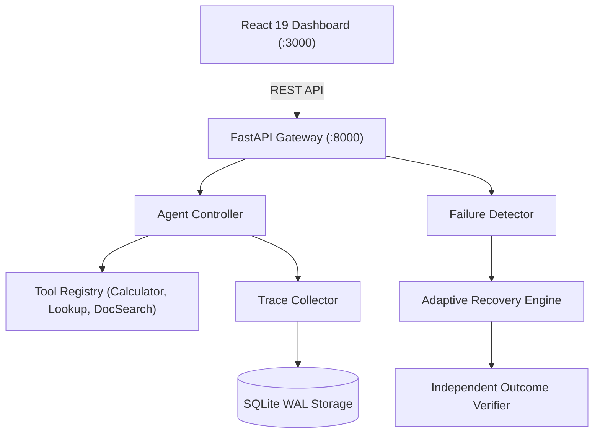

# TraceGuard System Architecture

## 1. System Overview

**TraceGuard: An Evidence-Driven Reliability and Recovery Platform for Tool-Using AI Agents** is an end-to-end framework designed to diagnose, intercept, and recover from tool-calling agent failures at runtime.

Unlike traditional agents that rely on unguided retries or unstructured error dumps, TraceGuard employs trajectory-based failure detection to pinpoint failure patterns and triggers targeted, budget-bounded recovery policies.

---

## 2. Component Directory Structure

| Subsystem | Primary Path | Responsibilities |
|---|---|---|
| **API Gateway** | `backend/main.py`, `backend/api/` | REST endpoints for tasks, traces, benchmarks, experiments, diagnostics, recovery, and system health. |
| **Agent Controller** | `backend/agents/controller.py` | Step loop, model adapter interaction, tool dispatch, and step-budget enforcement. |
| **Model Adapters** | `backend/agents/mock_model.py`, `backend/agents/model_adapter.py` | Pluggable interface supporting deterministic offline mock execution and live OpenAI LLMs. |
| **Tool Registry** | `backend/agents/tool_registry.py`, `backend/tools/` | Allowlist of strictly typed tools: Calculator, Data Lookup, Document Search. |
| **Trace Collector** | `backend/tracing/collector.py`, `backend/tracing/event_schema.py` | Structured event recorder capturing model requests, tool calls, results, and step counters. |
| **Failure Detector** | `backend/detection/failure_detector.py`, `backend/detection/feature_extractor.py` | Trajectory analyzer synthesizing rule-based, statistical, and semantic failure signals into structured diagnostic reports. |
| **Recovery Engine** | `backend/recovery/recovery_engine.py`, `backend/recovery/policies/` | Policy dispatcher that executes bounded interventions: exponential backoff, schema repair, anti-looping, evidence re-prompting, and reflection critique. |
| **Outcome Verifier** | `backend/verification/verifier.py` | Independent deterministic validator evaluating agent answers against exact values, numerical tolerances, or field requirements without leaking answers to the agent. |
| **Benchmark & Experiment** | `backend/evaluation/` | Versioned task dataset loader (v1.0), comparative experiment runner, and metrics calculator. |
| **Persistence Layer** | `backend/tracing/storage.py` | SQLite 3 engine operating in Write-Ahead Logging (WAL) mode with online backup and health checking. |
| **Web Dashboard** | `frontend/src/` | React 19 SPA featuring Overview KPIs, Task Run Inspector, Trace Timeline, Diagnostics Explorer, Recovery Inspector, and Benchmark Comparisons. |

---

## 3. Data Flow and Execution Lifecycle

1. **Submission**: Client submits a task description with optional execution budgets and verification rules to `POST /tasks` or launches a batch via `POST /experiments/run`.
2. **Execution**: The Agent Controller queries the selected model adapter. The model chooses to either invoke a registered tool or propose a final answer.
3. **Trace Recording**: Every action, tool invocation, duration, and token usage is captured as an immutable `TraceEvent` with millisecond timestamps and unique run identifiers.
4. **Outcome Verification**: When a final answer is proposed or execution terminates, the Independent Outcome Verifier evaluates the result against ground-truth criteria. Ground-truth values are strictly isolated from the agent's prompt context.
5. **Detection & Diagnosis**: Trace events are analyzed by the Failure Detector. If anomalies (e.g. repeated calls, schema errors, missing evidence) are detected, a structured `DiagnosticReport` is generated.
6. **Targeted Recovery**: When running in `traceguard_recovery` mode, the Recovery Engine selects the specific policy matched to the diagnostic category, applies targeted prompt adaptations or parameter repairs, and enforces strict retry and tool budgets.
7. **Persistence & Presentation**: Tasks, traces, diagnostics, and recovery reports are persisted to SQLite and rendered on the frontend dashboard in real-time.

---

## 4. Trust Boundaries and Security Isolation

- **Agent Prompt Boundary**: Ground-truth labels and evaluation rules reside exclusively in the Verifier and Benchmark Dataset. Neither the Agent Controller nor Recovery Engine injects expected answers into the prompt context.
- **Tool Sandbox**: Tools only access dedicated local datasets (`data/products.json`, `data/documents/`). Arbitrary shell execution and unauthorized filesystem traversals are prohibited.
- **Storage Isolation**: Trace exports enforce strict filename sanitization against header injection and directory traversal.
