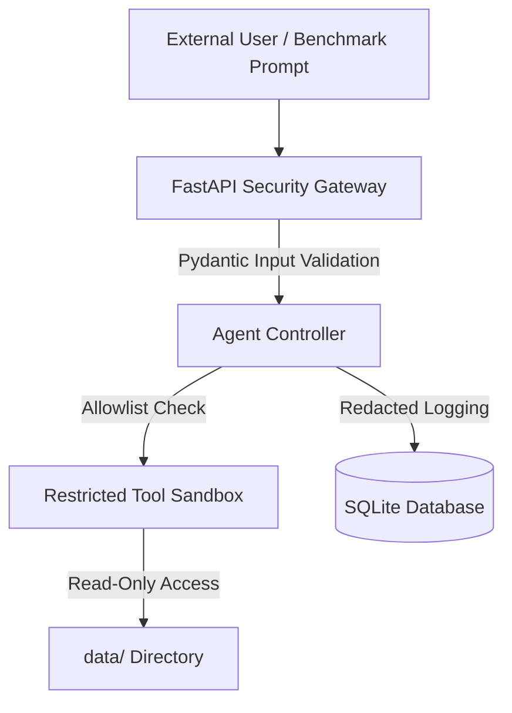

# TraceGuard Security Policy & Threat Model

## 1. Threat Model & Security Posture

TraceGuard is designed to operate safely in research, evaluation, and production environments. Tool-using AI agents present unique security and safety considerations because autonomous agents interact with external data sources and execution tools.

---

## 2. Security Controls Implemented

### A. API and Transport Security
- **Strict Input Validation**: All incoming requests are parsed and validated using Pydantic schemas (`TaskCreateRequest`, `ExperimentConfig`). Malformed payloads or oversized arrays are rejected with `422 Unprocessable Entity`.
- **Configurable CORS**: In production (`TRACEGUARD_ENV=production`), wildcard origins (`"*"`) are disallowed. Explicit, verified client origins must be provided.
- **Production Exception Masking**: Unhandled internal exceptions in production return generic error messages with an associated `request_id` to prevent stack trace or path disclosure.
- **Request Tracing**: All incoming requests receive a unique `X-Request-ID` header for end-to-end auditability.

### B. Agent Safety and Sandbox Controls
- **Tool Allowlisting**: Agents can only execute tools explicitly registered in `ToolRegistry` (`calculator`, `data_lookup`, `document_search`). Arbitrary shell execution (`os.system`, `subprocess`) or dynamic code evaluation (`eval()`, `exec()`) is prohibited.
- **Execution Budgets**: Agents operate under strict step limits (default 8, max 50) and timeouts.
- **Bounded Recovery Loops**: Recovery interventions cannot loop indefinitely. Global budgets enforce `RECOVERY_BUDGET_MAX_ATTEMPTS=2` and `RECOVERY_BUDGET_MAX_STEPS=5`.
- **Pre-execution Argument Schema Validation**: Every tool argument payload is validated against the tool's Pydantic `args_schema` prior to execution.

### C. Data & Secret Protection
- **No Private Keys in Frontend**: Model API keys (`OPENAI_API_KEY`) are backend-only environment variables and are never bundled into frontend builds or exposed in API responses.
- **Safe Environment Template**: `.env.example` contains only placeholder values. Real `.env` files and `.db` databases are excluded from Git via `.gitignore`.
- **Export Header Sanitization**: Trace and experiment file export endpoints sanitize filenames (`re.sub(r"[^a-zA-Z0-9_\-]", "_", id)`) to prevent HTTP response header injection (CRLF attacks) and directory traversal.
- **Reproducibility Manifest Sanitization**: Exported experiment manifests scrub all sensitive environment keys and credentials.

---

## 3. Known Limitations & Research Boundaries

- **In-Memory SQLite Concurrency**: SQLite in WAL mode handles multiple concurrent readers and sequential writes. For enterprise multi-node deployments with thousands of concurrent agents, an external PostgreSQL cluster is recommended.
- **Prompt Injection Defense**: Commercial LLMs remain susceptible to advanced indirect prompt injections embedded in external text documents. TraceGuard's architecture mitigates damage by restricting tool capabilities to read-only queries and mathematical operations.
